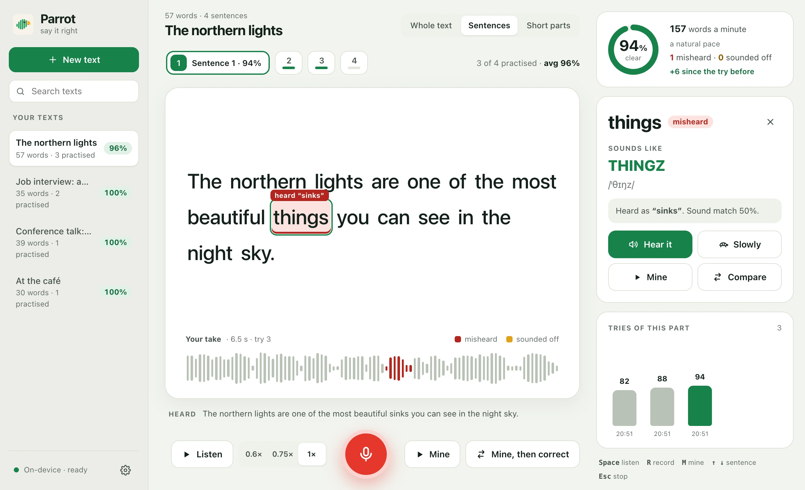

# Parrot

**Read a text aloud and see which words came out wrong.**

**[Download for macOS, Windows and Linux](https://qwertymuzaffar.github.io/parrot/)** · [Website](https://qwertymuzaffar.github.io/parrot/)



Parrot is a free, open-source desktop app for practising spoken English. Paste anything you need to say out loud (a job
interview introduction, a talk, a script), listen to it read correctly, record yourself, and Parrot shows you word by
word what came out wrong, how each word should sound, and lets you hear yours and the correct one side by side.
Transcription runs on your device (Whisper, offline): your voice is never uploaded.

## How it works

- **Listen.** Your text is split into sentences or short parts, and each one is read to you at the speed you choose,
  with the word being spoken lit up.
- **Record.** Read the part aloud. Parrot checks it two ways:
  - **Speech recognition** ([Whisper](https://github.com/openai/whisper) through
    [whisper.cpp](https://github.com/ggerganov/whisper.cpp)) writes down what it heard, without knowing the text. A word
    it heard as something else, or not at all, turns **red**, with what it heard.
  - **Forced alignment** finds each word of the text in your recording and scores how well the sounds match it. A word
    that scores clearly low turns **amber**: the listener guessed it, but it didn't sound right. The aligner is a
    wav2vec2 model trained on Mozilla Common Voice, so accents are expected, not marked down.
- **Fix.** Click any word to see how it sounds (a respelling like *sik·STEEN* and its IPA, from the
  [CMU Pronouncing Dictionary](https://github.com/cmusphinx/cmudict)), hear it alone or slowly, hear your own, or both
  one after the other. Every try is kept, so you can watch your score go up.

## On first launch

Parrot downloads its two speech models once, about 800 MB, then works offline:

| Model | Size | Source | Licence |
|---|---|---|---|
| Whisper small (English), for speech recognition | 465 MB | [ggerganov/whisper.cpp](https://huggingface.co/ggerganov/whisper.cpp) | MIT |
| wav2vec2 large XLSR-53, English, for the sound scores | 303 MB | [jonatasgrosman/wav2vec2-large-xlsr-53-english](https://huggingface.co/jonatasgrosman/wav2vec2-large-xlsr-53-english), exported to ONNX and quantised to 8 bits; served from this repository's `models-v1` release | Apache 2.0 |

The pronunciation dictionary ([CMUdict](https://github.com/cmusphinx/cmudict), BSD-style licence) is built in.

Texts and recordings are plain files in the app's data folder (macOS:
`~/Library/Application Support/io.github.qwertymuzaffar.parrot`, Windows: `%APPDATA%\io.github.qwertymuzaffar.parrot`,
Linux: `~/.local/share/io.github.qwertymuzaffar.parrot`).

## Development

Requirements: Node 22+, Rust, and CMake (to build whisper.cpp).

```bash
npm install
npx tauri dev                       # the desktop app, with the engine built in
npm test                            # interface tests
cd src-tauri && cargo test --lib    # engine tests
```

The engine (`src-tauri/src`): `store.rs` keeps texts and tries, `audio.rs` cleans a take, `asr.rs` runs Whisper,
`align.rs` places and scores each word, `text.rs` compares what was read with what was heard, `sounds.rs` respells a
word. `engine/` holds the first Python prototype, which the interface still uses when opened in a plain browser.

## Roadmap

1. A natural offline reference voice (Kokoro) for every text, which also makes the sound scores more exact.
2. More languages than English.

## Website

The download page is `docs/`, served by GitHub Pages. Its download buttons fill themselves in from the latest
published release, so nothing on it needs changing for a new version.

## Licence

MIT. The models keep their own licences (above). The Python prototype in `engine/` uses Meta's MMS aligner, which is
licensed CC-BY-NC; the app does not.
